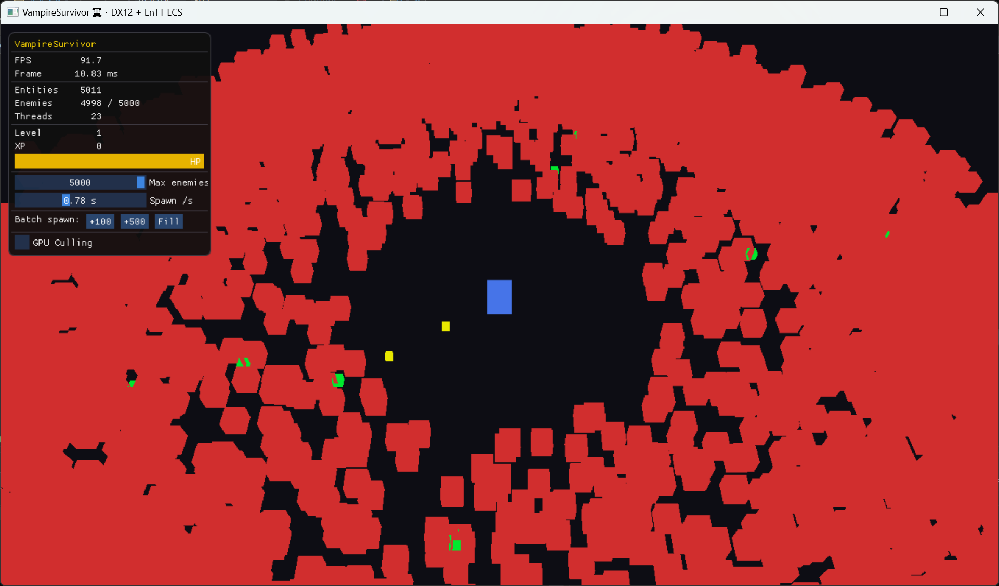

# DX12 ECS — Vampire Survivors Demo

A personal research project exploring **EnTT ECS**, **multi-threading**, and **DirectX 12 rendering performance** through a Vampire Survivors-style top-down game demo.



> Still actively being developed. New systems and optimisations are added regularly.

---

## Purpose

This project is a self-directed study of techniques that matter for real-time game engines:

- **Entity-Component-System (EnTT)** — data-oriented architecture, cache-friendly component layout
- **Job system / thread pool** — parallel enemy AI dispatched in 128-entity batches across worker threads
- **GPU-side culling** — compute shader frustum test + `ExecuteIndirect` eliminates invisible draw calls without CPU readback
- **DirectX 12** — explicit resource management, root signatures, descriptor heaps, PSOs, and command list recording

---

## Features

| System | Details |
|---|---|
| ECS (EnTT) | Player, Enemy, Bullet, XP Orb entities; component-based update loop |
| Thread Pool | `std::thread` workers; enemy AI dispatched as parallel jobs each frame |
| Instanced Rendering | Single `DrawIndexedInstanced` call for all entities via structured buffer |
| GPU Frustum Culling | CS dispatches one thread per instance; visible instances compacted via `InterlockedAdd`; draw args generated on GPU; rendered with `ExecuteIndirect` |
| ImGui Debug Panel | Real-time FPS, entity count, enemy count, thread count, player HP/level bar, max-enemies slider, GPU culling toggle |

---

## Tech Stack

- **Language**: C++20
- **Renderer**: DirectX 12 (Windows)
- **ECS**: [EnTT](https://github.com/skypjack/entt) (single-header, bundled in `third_party/`)
- **UI**: Dear ImGui (DX12 backend, bundled in `VampireSurvivor/ImGUI/`)
- **Build**: Visual Studio 2022, MSBuild, HLSL shaders compiled to `.cso` at build time

---

## Build

1. Open `D3D12HelloWorld.sln` in **Visual Studio 2022**
2. Select the **VampireSurvivor** project, platform **x64**, configuration **Debug** or **Release**
3. Build — shaders are compiled automatically as a pre-build step
4. Run from Visual Studio (F5) or navigate to `VampireSurvivor/bin/x64/Debug/`

**Requirements**: Windows 10/11, DirectX 12-capable GPU, Visual Studio 2022 with C++ desktop workload and Windows SDK 10.0+.

---

## Project Structure

```
D3D12HelloWorld.sln
VampireSurvivor/
  src/
    ecs/          Components, World, SystemGraph
    game/         GameApp (main loop), Systems (AI, combat, XP)
    jobs/         ThreadPool, TaskGraph
    rendering/    InstancedRenderer (CPU + GPU-cull paths)
    framework/    DX12 base classes (DXSample, Win32Application)
  shaders/
    instance.hlsl        VS + PS for instanced entity rendering
    gpu_cull_cs.hlsl     Compute shader frustum culling + indirect args
  ImGUI/                 Dear ImGui source (DX12 backend)
third_party/
  entt/entt.hpp          EnTT single-header ECS library
```

---

## Roadmap

- [x] EnTT ECS architecture
- [x] Thread pool parallel AI
- [x] Instanced rendering (CPU path)
- [x] GPU frustum culling with `ExecuteIndirect`
- [x] ImGui real-time debug panel
- [ ] Performance benchmark data (FPS vs entity count, single-thread vs multi-thread)
- [ ] PIX / Tracy profiling integration
- [ ] Spatial hash for bullet–enemy collision
- [ ] Wave-based enemy spawner
